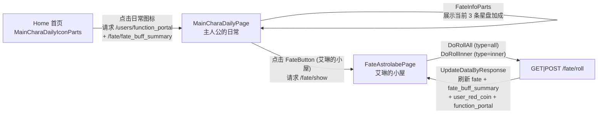
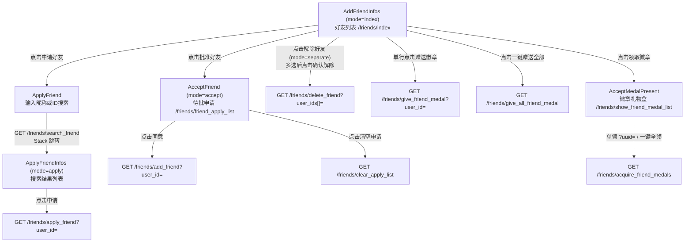

# 命运星盘与好友系统恢复规划

本文档定义 **M1 主人公养成子系统之「命运星盘（艾琳的小屋）」** 与 **M3 社交子系统之「好友与友情徽章」** 的开发任务规划、原服抓包（`.mlk`）双向契约核验矩阵及实机/模拟器端到端测试用例。

## 范围与裁剪边界

| 模块 | 本轮决策 | 裁剪与解耦说明 |
|---|---|---|
| **M1 命运星盘（艾琳的小屋）** | **本轮必做** | 完整恢复 `MainCharaDailyPage` 星盘汇总面板（`FateInfoParts`）与 `FateAstrolabePage`（`FateAstrolabeLeftParts` / `FateAstrolabeRightParts`）的读面、转动写面（免费首抽 / 18 钻全盘 / 10 钻内盘 / 高品质覆盖二次确认）及词条对同伴面板与结算的实际加成。 |
| **M1 主角光环 / 天赋树** | **不复原（2026-11-20 定为永久范围外，与同伴潜能同级）** | 不开发 `/main_chara_buff/*` 与 `/passive_skill/*` 养成写面；在 `/users/function_portal` 中可将 `chara_buff_button_disable` 置为 `true`（置灰「真·男主光环」按钮），并在 `/fate/fate_buff_summary` 的 `desc` 富文本中将「主角光环」分量固定渲染为 `+0` / `+0.00%`，实现星盘与光环的零耦合剥离。 |
| **M3 好友系统** | **独立可插拔工作包** | 与命运星盘完全正交（无共享表或交叉事务）。若本轮仅聚焦命运星盘，可只执行第一部分（FATE350）；若同步推进社交闭环，可并行执行第二部分（FRIEND350）。两套规划、契约与实机用例均在本篇完整给出。 |

---

## 第一部分：M1 命运星盘（艾琳的小屋）开发规划

### 1. 页面跳转链路与客户端消费组件

客户端通过首页「主人公的日常」图标进入二级页 `MainCharaDailyPage`，再点击「艾琳的小屋」进入 `FateAstrolabePage`。



#### 客户端 C# 组件与配置消费对账表

| 页面 / 组件 | 所在脚本 / 配置 | 消费缓存键 | 关键客户端逻辑与约束 |
|---|---|---|---|
| 首页日常图标红点 | `MainCharaDailyIconParts` | `function_portal.has_new_main_chara_daily` | 为 `true` 时在首页「主人公的日常」图标显示红点提示；当日未免费转盘（`today_roll_times == 0`）时置 `true`，首抽后置 `false`。 |
| 日常页「New」气泡 | `MainCharaDailyPage` -> `FateButtonNewParts` (`NoticeParts`) | `fate_buff_summary.disable_show_fate_new` | 注意字段语义为**反向布尔**：`false` 时显示 `New` 气泡（当日未转盘），`true` 时隐藏气泡（当日已转盘）。 |
| 日常页星盘汇总框 | `FateInfoParts` | `fate_buff_summary.summary_list` | `summary_list` 为空数组时展示引导底图 `common/bg-astrolabe_guide_desc`（`emptyGo`）；非空时最多取前 3 项，渲染 `total`（词条前缀）、`total_value`（总加成字符串）、`desc`（来源拆分说明）与 `rank`（调用 `UIUtil.GetFateRankSprite` 映射为 `icon-arrow_up_1/2/3`）。 |
| 星盘页顶部货币栏 | `FateAstrolabePage` (`DoubleDiamondConditionPartial`) | `user_coin.amount`、`user_red_coin.amount` | 页面声明 `requireData.user_red_coin.path = "/users/preset_data/"`。若 `preset_data.json` 未注入 `user_red_coin`，客户端进入星盘页会请求 `/users/preset_data/` 并在转动时因 `DataCache.Get("user_red_coin")` 为空抛 `NullReferenceException`。 |
| 星盘左半区（轮盘动画） | `FateAstrolabeLeftParts` | `fate.fate_list` | 维护外盘 8 扇区与内盘指针旋转动画；接收 `RollAstrolabe` / `RollInnerAstrolabe` 消息后转动 2.0 秒，完成后回调右侧组件刷新词条。 |
| 星盘右半区（词条与按钮） | `FateAstrolabeRightParts` | `fate`、`user_red_coin`、`temp_fate_roll_result` | 1. 顶部 `dailyLuckLabel` 读 `fate.daily_luck_desc`。<br>2. `fate.today_roll_times == 0` 时：`rollAllButton` 隐藏钻石图标、价格文本显示免费（`C_FATE_ASTROLABE_FREE_ROLL`），`rollInnerButton.isEnabled = false`（置灰不可点）。<br>3. `fate.today_roll_times > 0` 时：`rollAllButton` 显示 `roll_all_price`（`18`），`rollInnerButton` 启用并显示 `roll_inner_price`（`10`）。<br>4. 点击转动时校验 `user_red_coin.amount >= price`（免费首抽除外），不足则弹 `C_FATE_ASTROLABE_RED_DIAMOND_NOT_ENOUGH`。 |

---

### 2. 原服抓包（`.mlk`）协议契约还原

以下契约由原服实机抓包样本（`fate_show*.json` 5 份、`fate_fate_buff_summary*.json` 13 份、`fate_roll*.json` 4 份、`main_chara_buff_upgrade_infos*.json` 4 份）与客户端反编译代码交叉锁定。

#### 2.1 `GET|POST /fate/show`（星盘详情读面）

- **当日未转盘态（`today_roll_times == 0`）**：

```json
{
  "data": {
    "fate": {
      "daily_luck_desc": "如果感到迷茫，那就去依赖他人吧",
      "roll_all_price": 18,
      "roll_inner_price": 10,
      "today_roll_times": 0,
      "fate_list": []
    }
  }
}
```

- **当日已转盘态（`today_roll_times >= 1`）**：

```json
{
  "data": {
    "fate": {
      "daily_luck_desc": "如果感到迷茫，那就去依赖他人吧",
      "roll_all_price": 18,
      "roll_inner_price": 10,
      "today_roll_times": 1,
      "fate_list": [
        {
          "id": "unit_wind_hp",
          "name": "风之生命",
          "desc": "风系同伴体力增加11.60%",
          "desc_prefix": "风系同伴体力增加",
          "desc_suffix": "11.60%",
          "rank": "good",
          "value": 0.116
        },
        {
          "id": "guild_battle_pray_gp",
          "name": "祈祷信仰",
          "desc": "公会战每次祈祷获得的GP增加7",
          "desc_prefix": "公会战每次祈祷获得的GP增加",
          "desc_suffix": "7",
          "rank": "normal",
          "value": 7
        },
        {
          "id": "unit_water_hp",
          "name": "水之生命",
          "desc": "水系同伴体力增加5.60%",
          "desc_prefix": "水系同伴体力增加",
          "desc_suffix": "5.60%",
          "rank": "normal",
          "value": 0.056
        }
      ]
    }
  }
}
```

#### 2.2 `GET|POST /fate/fate_buff_summary`（日常页星盘汇总读面）

- **当日未转盘态**：

```json
{
  "data": {
    "fate_buff_summary": {
      "summary_list": [],
      "disable_show_fate_new": false
    }
  }
}
```

- **当日已转盘态（放弃主角光环后，光环分量恒为 `+0` / `+0.00%`）**：

```json
{
  "data": {
    "fate_buff_summary": {
      "summary_list": [
        {
          "total": "风系同伴体力增加",
          "total_value": "+11.60%",
          "desc": "主角光环[eb8900]+0.00%[-]，星盘[eb8900]+11.60%[-]",
          "rank": "good"
        },
        {
          "total": "公会战每次祈祷获得的GP增加",
          "total_value": "+7",
          "desc": "主角光环[eb8900]+0[-]，星盘[eb8900]+7[-]",
          "rank": "normal"
        },
        {
          "total": "水系同伴体力增加",
          "total_value": "+5.60%",
          "desc": "主角光环[eb8900]+0.00%[-]，星盘[eb8900]+5.60%[-]",
          "rank": "normal"
        }
      ],
      "disable_show_fate_new": true
    }
  }
}
```

#### 2.3 `GET|POST /fate/roll`（转动星盘写面）

- **请求参数**：
  - `type`：`"all"`（转动星盘：重抽 3 个不重复词条 ID + 品质数值）或 `"inner"`（只转内盘：保留当前 3 个词条 ID，仅重抽品质与数值；要求 `today_roll_times >= 1`）。
  - `confirm`：`"false"` 或 `"true"`（客户端默认传 `"false"`；当服务端检测到当前 `fate_list` 含高品质词条如 `amazing` 且 `confirm == "false"` 时，可触发二次确认分支）。
- **分支 A：高品质覆盖二次确认响应（`FateAstrolabeRightParts.cs:344/385`）**
  当 `confirm != "true"` 且当前已存在 `rank == "amazing"` 词条时，返回：

```json
{
  "astrolabe_need_confirm": true,
  "modal": {
    "title": "确认",
    "type": "yes_no",
    "body": "当前星盘中含有极佳运势，重新转动将覆盖现有加成，是否确认转动？"
  },
  "data": {
    "temp_fate_roll_result": false
  }
}
```

  客户端收到 `temp_fate_roll_result == false` 且顶层 `astrolabe_need_confirm == true` 时，通过 `ResponseFilter` 弹出 `yes_no` 确认框，玩家点击确定后自动重发 `confirm=true`。
- **分支 B：转动成功响应（`.mlk` 实机抓包对齐）**
  原服在成功转动后**一次性下发 6 个顶层 `data` 键**，使星盘页、顶部红钻栏、返回日常页后的汇总框和红点同步更新：

```json
{
  "data": {
    "fate": {
      "daily_luck_desc": "如果感到迷茫，那就去依赖他人吧",
      "roll_all_price": 18,
      "roll_inner_price": 10,
      "today_roll_times": 2,
      "fate_list": [ "..." ]
    },
    "temp_fate_roll_result": true,
    "user_red_coin": {
      "amount": 1033
    },
    "user_coin": {
      "amount": 1033
    },
    "fate_buff_summary": {
      "summary_list": [ "..." ],
      "disable_show_fate_new": true
    },
    "function_portal": {
      "has_new_main_chara_daily": false,
      "chara_buff_button_disable": true,
      "chara_buff_button_key": "真·男主光环",
      "fate_button_disable": false,
      "fate_button_key": "艾琳的小屋"
    },
    "user_units": null
  }
}
```

> **货币同步说明**：本服玩家钻石余额统一存储在 `cn35_player_balances.coin`。为保证顶部双钻栏（`DoubleDiamondConditionPartial` 同时展示 `user_coin` 与 `user_red_coin`）与抽卡/商店余额一致，扣费统一扣减 `coin`（首抽 0 钻、`type=all` 18 钻、`type=inner` 10 钻），并在 `/fate/roll` 响应中同时回推 `"user_red_coin": {"amount": balance}` 与 `"user_coin": {"amount": balance}`。

---

### 3. 22 种候选星盘词条目录与品质档位表

结合 `.mlk` 中 `/main_chara_buff/upgrade_infos` 披露的完整 22 种 `sub_type` 枚举与 `/fate/show`、`/fate/roll` 实机观测值，整理星盘候选词条池如下（标注为「原服观测」的条目来自 `.mlk` 实机样本，其余同族条目按对称档位重建）：

| 词条 `id` | `name` | `desc_prefix` | 格式类型 | `normal`（箭头1）区间 | `good`（箭头2）区间 | `amazing`（箭头3）区间 | 证据来源 |
|---|---|---|---|---|---|---|---|
| `unit_fire_hp` | 火之生命 | 火系同伴体力增加 | 百分比 (`0.00%`) | `3.00% ~ 6.00%` | `6.20% ~ 12.00%` | `12.20% ~ 18.00%` | 原服观测 (`4.80%`) |
| `unit_fire_atk` | 火之力量 | 火系同伴攻击增加 | 百分比 (`0.00%`) | `3.00% ~ 6.00%` | `6.20% ~ 12.00%` | `12.20% ~ 18.00%` | 同族重建 |
| `unit_fire_rate` | 火之士气 | 火系同伴救援出现率增加 | 百分比 (`0.00%`) | `5.00% ~ 10.00%` | `10.50% ~ 20.00%` | `20.50% ~ 30.00%` | 同族重建 |
| `unit_water_hp` | 水之生命 | 水系同伴体力增加 | 百分比 (`0.00%`) | `3.00% ~ 6.00%` | `6.20% ~ 12.00%` | `12.20% ~ 18.00%` | 原服观测 (`5.60%`, `9.20%`) |
| `unit_water_atk` | 水之力量 | 水系同伴攻击增加 | 百分比 (`0.00%`) | `3.00% ~ 6.00%` | `6.20% ~ 12.00%` | `12.20% ~ 18.00%` | 原服观测 (`8.80%`) |
| `unit_water_rate` | 水之士气 | 水系同伴救援出现率增加 | 百分比 (`0.00%`) | `5.00% ~ 10.00%` | `10.50% ~ 20.00%` | `20.50% ~ 30.00%` | 原服观测 (`12.50%`) |
| `unit_wind_hp` | 风之生命 | 风系同伴体力增加 | 百分比 (`0.00%`) | `3.00% ~ 6.00%` | `6.20% ~ 12.00%` | `12.20% ~ 18.00%` | 原服观测 (`11.60%`) |
| `unit_wind_atk` | 风之力量 | 风系同伴攻击增加 | 百分比 (`0.00%`) | `3.00% ~ 6.00%` | `6.20% ~ 12.00%` | `12.20% ~ 18.00%` | 同族重建 |
| `unit_wind_rate` | 风之士气 | 风系同伴救援出现率增加 | 百分比 (`0.00%`) | `5.00% ~ 10.00%` | `10.50% ~ 20.00%` | `20.50% ~ 30.00%` | 同族重建 |
| `unit_light_hp` | 光之生命 | 光系同伴体力增加 | 百分比 (`0.00%`) | `3.00% ~ 6.00%` | `6.20% ~ 12.00%` | `12.20% ~ 18.00%` | 同族重建 |
| `unit_light_atk` | 光之力量 | 光系同伴攻击增加 | 百分比 (`0.00%`) | `3.00% ~ 6.00%` | `6.20% ~ 12.00%` | `12.20% ~ 18.00%` | 同族重建 |
| `unit_light_rate` | 光之士气 | 光系同伴救援出现率增加 | 百分比 (`0.00%`) | `5.00% ~ 10.00%` | `10.50% ~ 20.00%` | `20.50% ~ 30.00%` | 同族重建 |
| `unit_dark_hp` | 暗之生命 | 暗系同伴体力增加 | 百分比 (`0.00%`) | `3.00% ~ 6.00%` | `6.20% ~ 12.00%` | `12.20% ~ 18.00%` | 同族重建 |
| `unit_dark_atk` | 暗之力量 | 暗系同伴攻击增加 | 百分比 (`0.00%`) | `3.00% ~ 6.00%` | `6.20% ~ 12.00%` | `12.20% ~ 18.00%` | 同族重建 |
| `unit_dark_rate` | 暗之士气 | 暗系同伴救援出现率增加 | 百分比 (`0.00%`) | `5.00% ~ 10.00%` | `10.50% ~ 20.00%` | `20.50% ~ 30.00%` | 同族重建 |
| `guild_battle_attak_gp` | 圣战信仰 | 公会战每次出击获得的GP增加 | 整数 (`+%d`) | `10 ~ 25` | `30 ~ 60` | `65 ~ 100` | 名城/前缀来自 `.mlk`（注：原服拼写即为 `attak_gp`） |
| `guild_battle_help_gp` | 声援信仰 | 公会战每次声援获得的GP增加 | 整数 (`+%d`) | `2 ~ 5` | `6 ~ 12` | `13 ~ 20` | 原服观测 (`2`) |
| `guild_battle_pray_gp` | 祈祷信仰 | 公会战每次祈祷获得的GP增加 | 整数 (`+%d`) | `5 ~ 10` | `11 ~ 20` | `21 ~ 30` | 原服观测 (`7`) |
| `guild_battle_per_con` | 贡献信仰 | 公会战每次获得的个人贡献增加 | 百分比 (`0.00%`) | `5.00% ~ 10.00%` | `10.50% ~ 20.00%` | `20.50% ~ 30.00%` | 名称/前缀来自 `.mlk` |
| `gold_drop_main` | 探险财运 | 主线探险获得的金币增加 | 百分比 (`0.00%`) | `5.00% ~ 15.00%` | `16.00% ~ 30.00%` | `31.00% ~ 50.00%` | 名称/前缀来自 `.mlk` |
| `gold_drop_daily` | 日常财运 | 每日探险获得的金币增加 | 百分比 (`0.00%`) | `5.00% ~ 15.00%` | `16.00% ~ 30.00%` | `31.00% ~ 50.00%` | 名称/前缀来自 `.mlk` |
| `gold_drop_spring` | 泉水财运 | 不可思议之泉获得的金币增加 | 百分比 (`0.00%`) | `5.00% ~ 15.00%` | `16.00% ~ 30.00%` | `31.00% ~ 50.00%` | 原服观测 (`24.00%`) |

> **抽奖池实效边界说明**：`FateBuffCatalog` 完整收录上述 22 种词条定义以兼容 `.mlk` 历史抓包与按 ID 反查；由于当前版本战斗下发的 `help_table` 固定为空表（未启用随机救援同伴出场），五系救援率词条（`unit_*_rate`）不进入 `RollableFateBuffCatalog` 随机抽取池，实际抽取池由其余 **17 种具备完整服务端数值加成的词条**组成（五系生命/攻击 10 种 + 公会战 GP/个人贡献 4 种 + 主线/日常/泉水金币 3 种）。

---

### 4. 数据库设计与开发任务拆解（FATE350）

#### 4.1 SQLite 迁移表设计（新增迁移 `cn35_player_fate`）

遵循历史迁移只增不改原则，新增一张玩家每日星盘状态表与转动台账表：

```sql
-- 玩家命运星盘当前状态（按 period_key 每日重置 today_roll_times 与词条）
CREATE TABLE IF NOT EXISTS cn35_player_fate (
    user_id          TEXT    NOT NULL PRIMARY KEY,
    period_key       TEXT    NOT NULL, -- 东八区日周期键（如 2026-11-07，对齐 04:00 刷新边界）
    daily_luck_desc  TEXT    NOT NULL DEFAULT '',
    today_roll_times INTEGER NOT NULL DEFAULT 0,
    fate_list_json   TEXT    NOT NULL DEFAULT '[]', -- 3 条当前生效词条 JSON
    updated_at       INTEGER NOT NULL
);

-- 命运星盘转动扣费台账（审计与故障排查）
CREATE TABLE IF NOT EXISTS cn35_player_fate_ledger (
    id               INTEGER PRIMARY KEY AUTOINCREMENT,
    user_id          TEXT    NOT NULL,
    period_key       TEXT    NOT NULL,
    roll_type        TEXT    NOT NULL, -- 'all' | 'inner'
    roll_seq         INTEGER NOT NULL, -- 当日第几次转动（1=免费首抽）
    cost_coin        INTEGER NOT NULL, -- 0 | 18 | 10
    fate_list_json   TEXT    NOT NULL,
    created_at       INTEGER NOT NULL
);
```

#### 4.2 开发任务分解（共 4 个子任务，预计 1.5 ~ 2 人日）

| 任务编号 | 任务名称 | 涉及文件 | 具体实现内容 |
|---|---|---|---|
| **FATE350-01** | 星盘规则表与 Store 持久化层 | `server/internal/database/migrations/<next>_cn35_player_fate.sql`<br>`server/internal/cn35game/fate.go`<br>`server/internal/cn35store/fate.go` | 1. 定义 `FateEntry`、`FateSnapshot`、`FateStore` 接口及 22 种候选词条目录、每日运势签文池。<br>2. 实现跨日自动重置判定（当数据库记录的 `period_key != currentPeriodKey` 时，读取自动归零 `today_roll_times = 0`、`fate_list = []`，并按 `user_id + period_key` 确定性生成当日 `daily_luck_desc`）。<br>3. 实现 `RollFate(userID, periodKey, rollType, confirm)` 单事务：校验 `inner` 必须 `today_roll_times >= 1`；若含 `amazing` 且 `!confirm` 返回 `ErrFateNeedConfirm`；计算费用（首抽 `all` 为 `0`，后续 `all` 为 `18`，`inner` 为 `10`），原子扣减 `cn35_player_balances.coin`，更新 `cn35_player_fate` 并写 `cn35_player_fate_ledger`。 |
| **FATE350-02** | 星盘 Wire 协议层与入口联动 | `server/internal/cn35game/fate_wire.go`<br>`server/internal/cn35game/daily_shop_wire.go`<br>`server/internal/cn35game/business.go`<br>`server/internal/cn35game/module_requiredata.go`<br>`server/internal/cn35game/cn35game.go` | 1. 注册 `GET|POST /fate/show`、`GET|POST /fate/fate_buff_summary`、`GET|POST /fate/roll`；在 `module_requiredata.go` 中将 `/fate/show` 与 `/fate/fate_buff_summary` 让位给真实 handler。<br>2. 在 `presetDataHandler`（`business.go`）中注入 `data["user_red_coin"] = snap.UserCoin`（并同步在扣钻/领钻处回推 `user_red_coin`），同时注册 `/users/preset_data` 别名防止 `FateAstrolabePage` / `RedDiamondShop` 缓存缺失时触发 501。<br>3. 联动 `functionPortalHandler`（`daily_shop_wire.go`）：根据当日 `today_roll_times == 0` 动态返回 `has_new_main_chara_daily: true/false`，并将已放弃的光环按钮 `chara_buff_button_disable` 设为 `true`。 |
| **FATE350-03** | 星盘词条数值加成接入 | `server/internal/cn35game/LoginBonus` / `questResultHandler` / `guild_battle_wire.go` | 1. **经济类词条**：在不可思议之泉领取（`gold_drop_spring`）、主线结算（`gold_drop_main`）、日常探险结算（`gold_drop_daily`）计算金币时读取当日激活的星盘倍率。<br>2. **公会战词条**：在公会战出击（`guild_battle_attak_gp`）、声援（`guild_battle_help_gp`）、祈祷（`guild_battle_pray_gp`）与个人贡献（`guild_battle_per_con`）结算时叠加当日星盘固定值/百分比。<br>3. **五系同伴属性词条**：客户端 `Piece.cs` 不直接读 `fate`，原服通过服务端或同伴快照生效；在战斗/会战属性计算或 `user_units` 下发中接入可选加成钩子。 |
| **FATE350-04** | 单元测试与 `.mlk` 契约回归测试 | `server/internal/cn35game/fate_wire_test.go` | 覆盖空态首进、免费首抽、18 钻全盘重抽、10 钻内盘锁词条重抽、余额不足拦截、`amazing` 覆盖二次确认、跨 04:00 周期重置及 `.mlk` 响应键全集比对测试。 |

---

## 第二部分：M3 好友系统开发规划（独立可插拔工作包）

> **执行说明**：若本轮开发决定同时覆盖 M3 好友系统，按本节执行；若本轮仅执行命运星盘，本节作为后续 M3 排期的完整技术规格书保留。

### 1. 页面跳转链路与客户端消费组件

客户端从底部菜单或主页进入好友列表 `AddFriendInfos`，通过右侧组件按钮切换「解除好友」模式，或跳转至「申请好友 (`ApplyFriend` -> `ApplyFriendInfos`)」、「批准申请 (`AcceptFriend`)」、「领取友情徽章 (`AcceptMedalPresent`)」。



#### 客户端 C# 组件消费对账表

| 组件名 | 关联页面 | 消费缓存键 | 关键客户端逻辑与约束 |
|---|---|---|---|
| `FriendButtonListComponent` | `AddFriendInfos` | `friends`、`friend_count`、`friend_count_limit`、`friend_medal_count`、`medal_package_count`、`send_all_friend_preset_open` | 1. **关键开关**：`InitButton()`（第 96 行）检查 `DataCache.Get("send_all_friend_preset_open").json.b`，为 `true` 时才显示「一键赠送」按钮（`sendAllFriendButton`）。<br>2. `medal_package_count > 0` 时在「领取徽章」按钮上显示待领红点角标。<br>3. 点击「解除好友」在页内切换 `mode=separate`，多选后调用 `/friends/delete_friend?user_ids[]=...`。 |
| `FriendInfoListRow` | `AddFriendInfos` / `AcceptFriend` / `ApplyFriendInfos` | 行对象：`user_id`、`name`、`unit_id`、`level`、`guild_name`、`logged_at`、`can_give_medal` | 1. 根据页面 `mode` 切换右侧按钮：`index` 显示「赠送徽章」（`can_give_medal == true` 时可点）、`apply` 显示「申请」、`accept` 显示「承认」、`separate` 显示多选勾选框。<br>2. 点击头像跳转 `UserPage&user_id=<uid>`（触发 `/users/show?user_id=<uid>`）。 |
| `ApplyFriendParts` | `ApplyFriend` | `/friends/search_friend` 响应的 `data.users` | 支持按玩家昵称（`?name=`）或按玩家 ID（`?user_id=`）搜索；回调 `UpdateDataByResponse` 将 `users` 写入缓存后 `Stack` 打开 `ApplyFriendInfos`。 |
| `AcceptFrindButtonListComponent` | `AcceptFriend` | `friends_apply`、`friend_count`、`friend_count_limit` | 展示当前好友数 `friend_count / friend_count_limit`；提供「清空申请列表」按钮（调用 `/friends/clear_apply_list`）。 |
| `FriendPresentInfoListRow` & `AccpetPresentButtonListComponent` | `AcceptMedalPresent` | `friend_medal_gifts`、`friend_medal_count` | 渲染每条待领友情徽章礼物（`uuid`、`created_at_sec`、`message`、`content.{user_id,name,unit_id,content_count}`）；支持单条领取（`?uuid=`）与全部领取（无参）。 |

---

### 2. 原服抓包（`.mlk`）好友协议契约还原

以下契约由原服抓包样本（`friends_index*.json` 4 份、`friends_friend_apply_list*.json` 3 份、`friends_show_friend_medal_list*.json` 2 份、`friends_search_friend.json` 1 份、`friends_add_friend.json` 1 份、`friends_delete_friend.json` 1 份、`friends_give_all_friend_medal*.json` 7 份）与 C# 反编译代码交叉锁定。

#### 2.1 `GET|POST /friends/index`（好友列表主页）

```json
{
  "data": {
    "friend_count_limit": 30,
    "friend_count": 2,
    "friend_medal_count": 4675,
    "medal_package_count": 1,
    "send_all_friend_preset_open": true,
    "friends": [
      {
        "user_id": "<friend_uid_1>",
        "name": "PlayerA",
        "unit_id": 1249,
        "level": 91,
        "guild_name": "示例公会",
        "logged_at": 1510029000,
        "can_give_medal": true
      },
      {
        "user_id": "<friend_uid_2>",
        "name": "PlayerB",
        "unit_id": 364,
        "level": 108,
        "guild_name": "无所属",
        "logged_at": 1510025400,
        "can_give_medal": false
      }
    ]
  }
}
```

#### 2.2 申请、搜索、批准、删除与清空契约

| 端点 | 请求参数 | 响应结构（`.mlk` 与客户端消费对齐） |
|---|---|---|
| `GET\|POST /friends/friend_apply_list` | 无 | `{"data": {"friends_apply": [{"user_id": "...", "name": "...", "unit_id": 1207, "level": 93, "guild_name": "...", "logged_at": 1509980000}], "friend_count": 2, "friend_count_limit": 30}}` |
| `GET\|POST /friends/search_friend` | `user_id=<uid>&name=<name>` | `{"data": {"users": [{"user_id": "...", "name": "...", "unit_id": 491, "level": 78, "logged_at": 1510029000, "guild_name": "..."}]}}` |
| `GET\|POST /friends/apply_friend`（含 `/friends/apply_friend_2`） | `user_id=<uid>` | `{"result": true, "msg": "已发送好友申请。"}`（异常时 `result: false` 并带具体原因 `msg`） |
| `GET\|POST /friends/add_friend` | `user_id=<uid>` | 满员失败（`.mlk` 原文）：`{"result": false, "msg": "好友已满，无法添加"}`<br>成功：`{"result": true, "msg": "已添加为好友。", "data": {"friend_count": 3, "friends": [...], "friends_apply": [...]}}` |
| `GET\|POST /friends/delete_friend` | `user_ids[]=<uid1>&user_ids[]=<uid2>` | `.mlk` 原文：`{"result": true, "data": {"friend_count": 29, "friends": [...]}}` |
| `GET\|POST /friends/clear_apply_list` | 无 | `{"result": true, "msg": "已清空好友申请列表。", "data": {"friends_apply": []}}` |

#### 2.3 友情徽章赠送与领取契约（含 CP 溢出确认分支）

- **`GET|POST /friends/give_all_friend_medal`（一键赠送全部好友徽章）**
  - **规则（`.mlk` 7 份样本锁定）**：每向 1 位 `can_give_medal == true` 的好友赠送友情徽章，发起方获得 **1 个友情徽章 + 4 点 CP**（公会建设点，单日通过好友获赠 CP 上限为 `friend_count_limit * 4 = 120`，玩家持有 CP 上限 `max_cp` 通常为 `2500`），同时为对方生成 1 条友情徽章礼物记录（单机 NPC 好友也可每日双向回赠）。
  - **分支 A：CP 即将超过上限且未传 `confirm=true`（`.mlk` 原文）**：

```json
{
  "modal": {
    "title": "确认",
    "type": "yes_no",
    "body": "CP将超过上限，超过部分无法获得，是否确定赠送全部好友友情徽章",
    "url": "/friends/give_all_friend_medal?_method=GET&confirm=true"
  },
  "data": {
    "user": { "...": "..." },
    "user_memo": 0
  }
}
```

  - **分支 B：正常赠送或 `confirm=true` 确认后（`.mlk` 原文）**：

```json
{
  "modal": {
    "title": "成功",
    "body": "赠送成功30个友情徽章，获得120点CP。"
  },
  "data": {
    "user": { "...": "含更新后的 cp 与 friend_medal" },
    "friend_count_limit": 30,
    "friend_count": 30,
    "friend_medal_count": 4695,
    "medal_package_count": 0,
    "friends": [ "...全部 can_give_medal 置为 false..." ]
  }
}
```

- **`GET|POST /friends/give_friend_medal?user_id=<uid>`（单人赠送）**
  - 针对单个好友置 `can_give_medal = false`，发起方 `friend_medal + 1`、`cp = min(max_cp, cp + 4)`，返回 `{"result": true, "modal": {"title": "成功", "body": "赠送成功1个友情徽章，获得4点CP。"}, "data": {"user": ..., "friend_medal_count": ..., "friends": [...]}}`。
- **`GET|POST /friends/show_friend_medal_list` 与 `/friends/acquire_friend_medals`**
  - `show_friend_medal_list` 返回：

```json
{
  "data": {
    "friend_medal_gifts": [
      {
        "uuid": "<gift_uuid>",
        "created_at_sec": 1510025122,
        "content": {
          "user_id": "<sender_uid>",
          "name": "PlayerA",
          "unit_id": 620,
          "content_count": 1
        },
        "message": "赠送你1个友情徽章。",
        "content_type_name": "friendmedal"
      }
    ]
  }
}
```

  - `acquire_friend_medals`（带 `?uuid=<gift_uuid>` 单领，不带 `uuid` 一键全领）：将对应礼物出盒，`cn35_player_balances.friend_medal` 增加对应数量，返回 `{"result": true, "msg": "领取成功。", "data": {"user": ..., "friend_medal_count": ..., "medal_package_count": ..., "friend_medal_gifts": [...]}}`。

---

### 3. 数据库设计与开发任务拆解（FRIEND350）

#### 3.1 SQLite 迁移表设计（`cn35_friends`）

```sql
-- 双向好友关系表（存 (user_id, friend_user_id) 对称两行，便于单侧索引与每日赠礼位记录）
CREATE TABLE IF NOT EXISTS cn35_player_friends (
    user_id            TEXT    NOT NULL,
    friend_user_id     TEXT    NOT NULL,
    last_give_period   TEXT    NOT NULL DEFAULT '', -- 东八区日周期键，等于当日则 can_give_medal=false
    created_at         INTEGER NOT NULL,
    PRIMARY KEY (user_id, friend_user_id)
);

-- 好友申请表
CREATE TABLE IF NOT EXISTS cn35_player_friend_applies (
    target_user_id     TEXT    NOT NULL, -- 被申请人
    applicant_user_id  TEXT    NOT NULL, -- 申请人
    created_at         INTEGER NOT NULL,
    PRIMARY KEY (target_user_id, applicant_user_id)
);

-- 友情徽章待领礼物盒
CREATE TABLE IF NOT EXISTS cn35_player_friend_medal_gifts (
    uuid               TEXT    PRIMARY KEY,
    user_id            TEXT    NOT NULL, -- 接收人
    sender_user_id     TEXT    NOT NULL,
    sender_name        TEXT    NOT NULL,
    sender_unit_id     INTEGER NOT NULL,
    count              INTEGER NOT NULL DEFAULT 1,
    created_at_sec     INTEGER NOT NULL
);

-- 每日友情徽章赠送持久记录（独立于好友关系存续，防止“赠送→解除→重加→再赠送”重复刷取）
CREATE TABLE IF NOT EXISTS cn35_player_friend_give_log (
    user_id            TEXT    NOT NULL,
    friend_user_id     TEXT    NOT NULL,
    last_give_period   TEXT    NOT NULL,
    updated_at         INTEGER NOT NULL,
    PRIMARY KEY (user_id, friend_user_id)
);
```

> **单机体验增强设计**：在单人离线/本地服环境下，若库内仅有当前玩家 1 个账号，搜索好友与收礼将为空。Store 层内置 **8~10 名固定种子 NPC 冒险者**（写入或虚拟投影为可搜索玩家），支持玩家搜索、秒批互加好友，且每次玩家向 NPC 好友赠送徽章时，NPC 自动回赠 1 枚友情徽章进入 `cn35_player_friend_medal_gifts`，使「搜索 -> 申请 -> 互加 -> 赠送得 CP -> 礼物盒领友情徽章 -> 徽章交换所消费」在单机模式下也能 100% 闭环。

#### 3.2 开发任务分解（共 3 个子任务，预计 2 ~ 2.5 人日）

| 任务编号 | 任务名称 | 涉及文件 | 具体实现内容 |
|---|---|---|---|
| **FRIEND350-01** | 好友关系、申请与徽章礼盒 Store 层 | `server/internal/database/migrations/<next>_cn35_friends.sql`<br>`server/internal/cn35game/friends.go`<br>`server/internal/cn35store/friends.go` | 实现好友列表查询、按名/按 ID 搜索（含本地真实玩家 + NPC 种子玩家）、申请、批准（双向建边 + 30 人上限校验）、批量删除、清空申请、单人/全员赠礼（原子加 `friend_medal` 与 `cp` + 触发 NPC 回礼）及徽章礼盒单领/全领事务。 |
| **FRIEND350-02** | `/friends/*` 11 个端点与外围社交挂载 | `server/internal/cn35game/friends_wire.go`<br>`server/internal/cn35game/module_requiredata.go`<br>`server/internal/cn35game/cn35game.go` | 注册 `/friends/index`、`/friends/friend_apply_list`、`/friends/search_friend`、`/friends/apply_friend`、`/friends/apply_friend_2`、`/friends/add_friend`、`/friends/delete_friend`、`/friends/clear_apply_list`、`/friends/give_friend_medal`、`/friends/give_all_friend_medal`、`/friends/show_friend_medal_list`、`/friends/acquire_friend_medals` 及玩家详情页 `/user_follows/*`、`/user_message_blocks/*` 轻量读写面。 |
| **FRIEND350-03** | 好友系统契约测试与 CP 溢出回归 | `server/internal/cn35game/friends_wire_test.go` | 覆盖搜索/申请/满员拦截/批量解绑/单赠/全赠 CP 溢出 `yes_no` 弹窗/礼盒单领与全领单元测试。 |

---

## 第三部分：配合 `.mlk` 抓包 Response 的双向验证方案

为确保服务端实现与原服协议及客户端 UI 严格一致，采用**「方向一：`.mlk` 抓包 Response 离线契约正向比对」+「方向二：实机/模拟器端到端逆向验收」**双向验证机制。

### 方向一：`.mlk` 抓包 Response 离线契约验证矩阵（服务端 -> 抓包真值）

在 `fate_wire_test.go` 与 `friends_wire_test.go` 中编写自动化 Schema 对账断言，将本服 handler 产出的 JSON 与 `.mlk` 解密样本逐键比对：

| 验证编号 | 目标端点 | 对照 `.mlk` 样本基准 | 必验结构与字段类型不变量 |
|---|---|---|---|
| **BV-FATE-01** | `/fate/show` | `default/fate_show.2.json`（未转态）<br>`default/fate_show.json`（已转态） | 1. 顶层必含 `data.fate`。<br>2. `fate` 必含 5 键：`daily_luck_desc` (`string`)、`roll_all_price` (`int == 18`)、`roll_inner_price` (`int == 10`)、`today_roll_times` (`int`)、`fate_list` (`array`)。<br>3. `today_roll_times == 0` 时 `fate_list` 长度必为 `0`；`>= 1` 时长度必为 `3`。<br>4. `fate_list[i]` 必含 7 键：`id`、`name`、`desc`、`desc_prefix`、`desc_suffix`、`rank` (`normal`\|`good`\|`amazing`)、`value` (`number`)，且 `desc == desc_prefix + desc_suffix`。 |
| **BV-FATE-02** | `/fate/fate_buff_summary` | `2/fate_fate_buff_summary.json`（未转态）<br>`default/fate_fate_buff_summary.json`（已转态） | 1. 顶层必含 `data.fate_buff_summary`。<br>2. 未转态：`summary_list == []` 且 `disable_show_fate_new == false`。<br>3. 已转态：`summary_list` 长度必为 `3` 且与 `/fate/show` 的 `fate_list` 顺序、品质、`desc_prefix` 一一对应；`disable_show_fate_new == true`。<br>4. `summary_list[i].desc` 颜色标签格式严格匹配 `"主角光环[eb8900]+0.00%[-]，星盘[eb8900]+<suffix>[-]"`（整数类为 `+0`）。 |
| **BV-FATE-03** | `/fate/roll` | `2/fate_roll.json`（首抽免费）<br>`default/fate_roll.2.json`（`type=inner`）<br>`default/fate_roll.json`（二次 `type=inner`） | 1. 成功态顶层 `data` 必同时包含 `fate`、`temp_fate_roll_result: true`、`user_red_coin: {amount}`、`user_coin: {amount}`、`fate_buff_summary`、`function_portal`、`user_units`。<br>2. 首抽（`today_roll_times: 0 -> 1`）前后 `user_red_coin.amount` / `user_coin.amount` 差值必为 `0`。<br>3. `type=all`（非首抽）前后差值必为 `-18`；`type=inner` 前后差值必为 `-10`，且 `type=inner` 前后 `fate_list[0..2].id` 顺序与值保持 100% 不变。 |
| **BV-FRD-01** | `/friends/index` | `default/friends_index.json` | 顶层 `data` 必含 `friend_count_limit` (`30`)、`friend_count`、`friend_medal_count`、`medal_package_count`、`send_all_friend_preset_open` (`true`)、`friends` 数组（每行含 7 键：`user_id`、`name`、`unit_id`、`level`、`guild_name`、`logged_at`、`can_give_medal`）。 |
| **BV-FRD-02** | `/friends/give_all_friend_medal` | `3/friends_give_all_friend_medal.2.json`（确认弹窗）<br>`3/friends_give_all_friend_medal.json`（确认执行） | 1. 当 `cp + 4*N > max_cp` 且无 `confirm=true` 时，顶层必返回 `modal.{title, type: "yes_no", body, url: "/friends/give_all_friend_medal?_method=GET&confirm=true"}`。<br>2. 带 `confirm=true` 或未超上限时，顶层必返回 `modal.{title: "成功", body}` 且 `data.friends` 中所有 `can_give_medal` 变为 `false`。 |
| **BV-FRD-03** | `/friends/show_friend_medal_list` | `3/friends_show_friend_medal_list.json` | `data.friend_medal_gifts[i]` 必含 `uuid`、`created_at_sec`、`message`、`content_type_name: "friendmedal"`、`content.{user_id, name, unit_id, content_count}`。 |

---

### 方向二：实机 / 模拟器端到端测试用例（客户端 UI -> 服务端落库）

> **前置环境约束**：所有实机/模拟器测试前，先遵循 `skills/cn35-apk-packaging/SKILL.md` 确认当前运行模式（外置 `mercd35` 服务端 + APK 或 单 APK 嵌入模式，严禁混用）。以下用例以独立 SQLite 状态库为准，不仅验证客户端画面渲染，还同时核验服务端请求日志与 SQLite 落盘结果。

#### 2.1 命运星盘（M1）实机测试用例表

| 用例编号 | 用例名称 | 前置条件 | 实机操作步骤 | 预期客户端 UI 表现 | 预期服务端响应与 SQLite 断言 |
|---|---|---|---|---|---|
| **TC-FATE-01** | 日常入口红点与未转盘空态展示 | 当日（04:00 后）账号未转动过星盘（`today_roll_times = 0`） | 1. 登录进入游戏首页 `Home`。<br>2. 观察左/右侧「主人公的日常」图标。<br>3. 点击进入「主人公的日常」（`MainCharaDailyPage`）。 | 1. 首页「主人公的日常」图标带红点（`has_new_main_chara_daily: true`）。<br>2. 进入日常页后，左侧「真·男主光环」按钮置灰不可点，「艾琳的小屋」按钮右上角显示 `New` 动画气泡。<br>3. 中央星盘面板显示引导说明图（`bg-astrolabe_guide_desc`），无报错弹窗。 | 请求 `/users/function_portal` 与 `/fate/fate_buff_summary` 返回 200；`summary_list` 为 `[]`，`disable_show_fate_new` 为 `false`。 |
| **TC-FATE-02** | 星盘首进与每日免费首抽（`type=all`） | 承接 TC-FATE-01，玩家持有钻石 `>= 0`（如 `1000` 钻） | 1. 点击「艾琳的小屋」进入 `FateAstrolabePage`。<br>2. 观察顶部双钻栏与右侧两颗按钮状态。<br>3. 点击左侧「转动星盘」按钮（免费）。 | 1. 顶部钻石与红钻正常显示 `1,000`（无 NRE 或 501）。<br>2. 初始右侧显示「今日还未占卜」，「转动星盘」显示「免费」，「只转内盘」按钮置灰禁用。<br>3. 点击后左侧星盘内外圈旋转约 2 秒停止，右侧刷出 3 条不同词条及对应颜色品质箭头（1/2/3 箭头）。<br>4. 钻石余额仍为 `1,000`（不扣钻），按钮变为消耗 `18` 钻，「只转内盘」变为亮起可点（消耗 `10` 钻）。 | `POST /fate/roll`（`type=all&confirm=false`）返回 `temp_fate_roll_result: true`；`cn35_player_fate.today_roll_times` 更新为 `1`，`cn35_player_balances.coin` 不变，`cn35_player_fate_ledger` 新增 `cost_coin = 0` 记录。 |
| **TC-FATE-03** | 只转内盘锁定词条重抽（`type=inner`） | 已完成首抽（当前 3 个词条 ID 记为 `A, B, C`，当前无 `amazing` 极佳词条，钻石 `1000`） | 1. 在「艾琳的小屋」点击右侧「只转内盘（10 钻）」按钮。<br>2. 等待内盘指针旋转动画结束，观察右侧 3 条词条与顶部钻石数。 | 1. 仅内盘指针旋转 2 秒。<br>2. 旋转结束后，右侧 3 条词条的名称与作用属性（`A, B, C`）**顺序与种类保持不变**，仅数值与品质箭头发生变化。<br>3. 顶部钻石与红钻立即从 `1,000` 变为 `990`。 | `POST /fate/roll`（`type=inner`）扣减 `10` 钻；响应中 `fate_list[0..2].id` 与转动前完全一致，`today_roll_times` 递增为 `2`。 |
| **TC-FATE-04** | 转动星盘全盘重抽（`type=all` 付费 18 钻） | 已完成首抽，当前无 `amazing` 词条，钻石 `990` | 1. 点击「转动星盘（18 钻）」按钮。<br>2. 等待内外盘旋转结束。 | 1. 内外盘同时旋转 2 秒。<br>2. 右侧重新抽出 3 条词条。<br>3. 顶部钻石与红钻从 `990` 变为 `972`。 | `POST /fate/roll`（`type=all`）扣减 `18` 钻，`today_roll_times` 递增为 `3`。 |
| **TC-FATE-05** | 极佳运势（`amazing`）覆盖二次确认弹窗 | 当前星盘 3 条词条中至少有 1 条为 `rank: "amazing"`（3 箭头） | 1. 点击「转动星盘」或「只转内盘」。<br>2. 在弹出的确认框先点「取消」，再点一次并选「确定」。 | 1. 首次点击不直接旋转，弹出 `yes_no` 确认框提示当前含极佳运势。<br>2. 点「取消」不扣钻、不旋转。<br>3. 点「确定」后触发旋转并正常扣钻刷新词条。 | 第一次请求（`confirm=false`）返回 `astrolabe_need_confirm: true` + `temp_fate_roll_result: false`；点确定后客户端自动发第二次请求（`confirm=true`）并落库扣钻。 |
| **TC-FATE-06** | 钻石不足客户端拦截与服务端兜底 | 将玩家钻石余额调整为 `5`（小于 `10` 且已完成首抽） | 1. 在「艾琳的小屋」分别点击「只转内盘（10 钻）」和「转动星盘（18 钻）」。 | 客户端直接弹出「红钻不足」提示框，轮盘不旋转，余额保持 `5` 不变。 | 客户端前置拦截不发请求；若绕过客户端直接构造请求，服务端同样返回业务拒绝且余额不扣成负数。 |
| **TC-FATE-07** | 返回日常页汇总面板同步与加成实效验证 | 已转出含「不可思议之泉获得的金币增加 X%」（或主线金币/公会战 GP 词条） | 1. 从「艾琳的小屋」点击返回按钮回到 `MainCharaDailyPage`。<br>2. 查看中央 `FateInfoParts` 面板与「艾琳的小屋」按钮。<br>3. 返回首页领取一次不可思议之泉（或通关一次主线）。 | 1. 「艾琳的小屋」右上角 `New` 气泡已消失；返回首页后「主人公的日常」红点已消失。<br>2. 日常页中央面板清晰列出 3 条加成，每条下方显示 `主角光环+0.00%，星盘+X.XX%`。<br>3. 泉水或关卡结算金币按 `(1 + value)` 倍率实际多发。 | SQLite 台账中泉水/关卡实发金币等于基础金币乘以星盘加成倍率（向下取整）。 |
| **TC-FATE-08** | 跨凌晨 04:00 周期重置与重启持久化 | 已完成转动（`today_roll_times >= 1`） | 1. 重启服务端进程，重进「艾琳的小屋」。<br>2. 将服务端判定时钟推进至次日 04:00 之后，重新进入「主人公的日常」与「艾琳的小屋」。 | 1. 重启后未跨天时，之前转出的 3 条词条与已转状态完整保留。<br>2. 跨过次日 04:00 后，日常入口红点与 `New` 气泡恢复，星盘清空回「今日还未占卜」，「转动星盘」恢复「免费」，「只转内盘」恢复置灰。 | 未跨天读库命中原 `period_key`；跨天后生成新 `period_key`，`today_roll_times` 归零。 |

---

#### 2.2 好友系统（M3，可选并行包）实机测试用例表

| 用例编号 | 用例名称 | 前置条件 | 实机操作步骤 | 预期客户端 UI 表现 | 预期服务端响应与 SQLite 断言 |
|---|---|---|---|---|---|
| **TC-FRD-01** | 好友列表首进与一键赠送按钮显隐 | 账号初始进入好友页 | 1. 点击菜单 -> 好友，进入 `AddFriendInfos`。 | 列表正常打开，显示好友数 `N/30`、持有友情徽章数，且右侧「一键赠送」按钮正常显示（由 `send_all_friend_preset_open: true` 驱动）。 | `POST /friends/index` 返回 200。 |
| **TC-FRD-02** | 搜索好友与发送好友申请 | 存在另一测试账号或内置种子 NPC 玩家 | 1. 点击「申请好友」进入 `ApplyFriend`。<br>2. 输入目标昵称或 ID 点击搜索。<br>3. 在跳转的 `ApplyFriendInfos` 列表中点击「申请」。 | 1. 搜索结果列表展示目标玩家头像、等级、所属公会、最后登录时间。<br>2. 点击「申请」后弹出提示框「已发送好友申请」。 | `/friends/search_friend` 返回 `data.users`；`/friends/apply_friend` 写入申请表（NPC 好友可配置自动通过）。 |
| **TC-FRD-03** | 批准好友申请与 30 人上限拦截 | `AcceptFriend` 列表中有待批申请 | 1. 进入「批准好友」页（`AcceptFriend`）。<br>2. 未满 30 人时点击「承认」；满 30 人时再次点击「承认」。<br>3. 点击「清空申请」。 | 1. 未满员时批准成功，该玩家移出申请列表并出现在好友列表中，`friend_count + 1`。<br>2. 满 30 人时弹出提示「好友已满，无法添加」。<br>3. 点击「清空申请」后列表清空。 | `/friends/add_friend` 在 `friend_count >= 30` 时返回 `{"result": false, "msg": "好友已满，无法添加"}`（对齐 `.mlk`）。 |
| **TC-FRD-04** | 单人赠送与一键赠送友情徽章（含 CP 溢出确认） | 拥有 `>= 1` 名 `can_give_medal == true` 的好友 | 1. 在好友列表点击某行「赠送徽章」。<br>2. 将玩家 CP 调至接近上限（如 `2498/2500`），点击「一键赠送」。<br>3. 在弹出的 `yes_no` 确认框点击「确定」。 | 1. 单人赠送后弹「赠送成功1个友情徽章，获得4点CP」，该行按钮置灰。<br>2. CP 临近上限点一键赠送时，弹出「CP将超过上限，超过部分无法获得，是否确定赠送全部好友友情徽章」。<br>3. 点确定后弹出成功提示，全部好友赠送按钮置灰，CP 封顶至 `2500`，友情徽章数增加。 | 首次请求返回 `modal.type = "yes_no"` 及 `url = "/friends/give_all_friend_medal?_method=GET&confirm=true"`；确认后更新 `last_give_period` 为当日。 |
| **TC-FRD-05** | 友情徽章礼物盒单领与一键全领 | 礼物盒中有待领友情徽章（如 NPC 回礼或他人赠送） | 1. 在好友页观察「领取徽章」按钮红点角标（`medal_package_count > 0`）。<br>2. 点击进入 `AcceptMedalPresent`。<br>3. 先点单行领取 1 枚，再点右上角「全部领取」。 | 1. 列表展示赠送人头像、昵称与「赠送你1个友情徽章」。<br>2. 单领后该行消失，持有友情徽章 `+1`。<br>3. 全部领取后列表清空，返回好友页后红点角标消失。 | `/friends/acquire_friend_medals` 事务删除 `cn35_player_friend_medal_gifts` 对应行并增加 `cn35_player_balances.friend_medal`。 |
| **TC-FRD-06** | 批量解除好友 | 好友列表中至少有 2 名好友 | 1. 在好友页点击「解除好友」切换至多选模式。<br>2. 勾选 1~2 名好友后点击确认解除。 | 被勾选好友从列表移除，好友计数 `friend_count` 相应减少，重启重进后依然保持已解除状态。 | `/friends/delete_friend?user_ids[]=...` 双向删除 `cn35_player_friends` 对应边并回推最新 `friends`。 |

