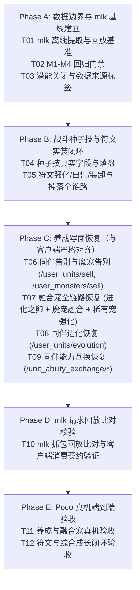

# CN3.5 M5：对抗性审查后重构计划（剔除潜能恢复、引入融合宠恢复、对齐原客户端代码与 mlk 回放校验）

## 0. 对抗性审查结论摘要（2026-11-08 修订）

本次对原 M5 任务清单（`PLAN.md` / `TASKS.md` / `ACCEPTANCE.md` / `tools/cn350_poco/m5_*`）进行了逐项对抗性审查，交叉比对了 `client/decoded/assets/bin/Data/Managed/Assembly-CSharp.dll` 反编译源码与 `../../cn-mercd-backend/artifacts/mlk-capture-201711/` 真实抓包，发现原计划存在以下**重大方向偏差与客户端契约失配**，已在本版计划中全面修正：

1. **范围修正一：剔除潜能系统（`潜能/被动技`）写面恢复，保留读面中性兼容字段**
   - 原计划将 `T06`（`/user_units/upgrade` 同伴潜能升级）及 Poco 用例 `M502`/`M503` 列为核心交付。
   - **修正**：国服不恢复潜能系统。运行态 `consts.unit_upgrade_open` 置为 `false`（客户端 `UserUnitDetail.cs:235` 自动隐藏右下潜能面板），写面 `/user_units/upgrade`、`/user_units/dismantle_confirm`、`/passive_skill/*` 保持显式拒绝；但 `user_units` 读面仍保留中性基线字段（`upgrade_level: 1`、`max_upgrade_level`、`passive_skill_slot_count: 0`、`passive_skills: []`），确保与 `mlk` 抓包 Schema 及客户端 `UserUnitDetail` / `ChangeAbilityParts` 字段读取 100% 兼容。
2. **范围修正二：完整引入 CN3.5「融合宠（魔宠融合 / 进化之卵）」恢复任务链**
   - 原计划 `T08` 误以为魔宠进化仅是单模态或单接口 `scale_limit` 提升，且 `m5_plan.json` (`M506`) 误将入口放在魔宠详情页 `UserMonsterDetail`（实际客户端 `UserMonsterDetail.cs` 根本没有进化按钮）。
   - **客户端真实逻辑（`MonsterButtonsListComponent.cs` + `MergeSelectCaseModal.cs` + `MergeEggUpModal.cs` + `MergeMonsterSelectMaterial.cs` + `MergeMonsteUpModal.cs` + `MonsterPowerupModal.cs`）**：
     - **功能开关**：`consts.monster_evo_open = true`（`DataCache.cs:379` → `MonsterButtonsListComponent.cs:302` 控制魔宠列表页 `mergeButton` 显隐）。
     - **分流模态（`MergeSelectCaseModal`）**：点击魔宠列表 `mergeButton` 请求 `/user_monsters/evolve_select_info`（`mlk` 抓包已完整捕获该响应），弹出 Step1「融合蛋（`mergeEggButton`）」与 Step2「选择魔宠（`mergeMonsterButton`）」双分支模态。
     - **分支 A：融合蛋培育（`MergeEggUpModal`）**：点击 `mergeEggButton` 请求 `/user_monsters/show_evolve_board` 下发 `data.show_monster_evo.egg_evo_config`（五系属性标签 `"0".."4"`、每系 4 档蛋配置）；点击合成发送 `/user_monsters/evolve_egg?attr_id=<1..5>&consume_monster_count=<n>`，消耗同属性未装备未保护的 1★ 完全体魔宠、神秘水晶（`content_type_id=107, id=1`）与金币，产出对应属性 1★~4★ 进化之卵（`content_type_id=106, id=100*attr_id+tier`，如 `mlk` 抓包实证的 `102`「稀有的火之蛋」）。
     - **分支 B：魔宠融合（`MergeMonsterSelectMaterial` → `MergeMonsteUpModal`）**：
       - **读面阻断 Bug 修复**：客户端 `MonsterButtonsListComponent.cs:412` 在 `merge_monster` 模式下仅允许点击 `formula_id > 0 && unit_id == "" && !protected` 的魔宠行。目前 `inventory_wire.go:516` 仅对已融合稀有宠（`batch >= 0`）下发 `formula_id = 1`，导致 5 只基础配方魔宠（`14` 诺滋风、`23` 飞拉、`26` 皮卡、`22` 针蜂、`24` 司坎德）`formula_id = 0` 无法被点击！而 `mlk` 抓包 `user_monsters.json` 明确实证 `id=26`（皮卡）具有 `formula_id: 1, batch: -1, is_rare: false`。
       - 点击可融合魔宠行请求 `/user_monsters/evolve_monster_select_info?uuid=<uuid>`，打开 `MergeMonsterSelectMaterial` 选择进化之卵或同类融合宠；确认后进入 `MergeMonsteUpModal`，点击执行发送 `/user_monsters/evolve?uuids=<uuid1|uuid2|...>&egg_item_id=<egg_id>`（**注意：`uuids` 为竖线 `|` 分隔字符串，而非 `uuids[]`**），融合产出五系融合宠（`100038..100041` 黛尼斯托、`100005..100008` 摩布拉、`100009..100012` 赫黎安提斯、`100042..100045` 梅赫莲恩、`100018..100021` 洛菲阿斯）或提升其融合度与 `scale_limit`（`1.800~2.300`）。
     - **分支 C：融合宠体型强化（`MonsterPowerupModal`）**：融合宠具有 `is_rare = true`（`scaleCategory.newMonster = true`，档位 `id = 6..10`，步长 `+0.01/次`，受 `scale_limit` 限制）。目前 `monster_powerup.go:92` 对 `is_rare == 1` 直接返回 `ErrMonsterRarePowerup`！必须同步补齐 `/user_monsters/rare_monster_category_config` 读面与 `monster_powerup.go` 稀有宠强化分支（按 `powerup_item_cnt` 扣素材、按 `gacha_points` 扣金币，推进至 `scale_limit`），融合宠才能完成养成闭环。
3. **范围修正三：客户端契约失配逐项纠正（同伴告别、魔宠告别、同伴进化、能力互换）**
   - **同伴告别（`/user_units/sell`）**：
     - 参数名是 `ids[]=<id>`（`UnitButtonsListComponent.cs:847`），**不是** `unit_ids[]` 或 `uuids[]`。
     - 入口在 `UserUnits` 列表页 `sellButton`（`UserUnitDetail` 详情页**无**告别按钮）。点击 `sellButton` 首先弹出「待机所 vs 告别」三键模态（`UnitButtonsListComponent.cs:698`）：**点击 `yesButton` 是进入待机所模式（`mode = "wait"`），点击 `noButton` 才是进入告别模式（`mode = "sell"`）**！原 `m5_plan.json` 未处理该分流模态。
     - 选行后点击 `decidedButton` 触发确认模态，若含 ★3 及以上（`rare_type_id >= 30`）还会触发**二次确认模态**（`COMMON_TITLE_CAUTION_2`）；且客户端强制校验剩余活动同伴数 `totalCount - selectedCount >= 5`（`UnitButtonsListComponent.cs:820`），服务端必须同步兜底。
   - **魔宠告别（`/user_monsters/sell`）**：
     - 参数名是 `uuids[]=<uuid>`，同时支持 `UserMonsterDetail.cs:453`（详情页单只告别）与 `MonsterButtonsListComponent.cs:625`（列表页批量选择 + `decidedButton` + ★3+ 二次确认）。
   - **同伴进化（`/user_units/evolution?id=<id>`）**：
     - `mlk` 抓包 `user_units.json` 实证有 44 名同伴携带非空 `evolution_map: {"id": <进化后unit_id>, "need": {"<素材id>": <数量>}}`，而当前 `inventory_wire.go:293-295` 硬编码了 `"is_evolutable": false, "evolution_map": {"id": 0, "need": {}}`。本计划纳入同伴进化读面 `evolution_map` 恢复与写面 `/user_units/evolution?id=<id>`（返回 `evolution_before`、`evolution_after`、`user_units`、`user_items`、`user`），与 `UnitEvolutionModal.cs:143` 完全对齐。
   - **同伴能力互换（`/unit_ability_exchange/*`）**：
     - 入口在 `UserUnits` 列表页 `changeAblityButton`（受 `consts.changeability_switch` 控制，`UnitButtonsListComponent.cs:488, 728`），**不在** `UserUnitDetail` 详情页（原 `m5_plan.json` `M507` 路径错误）。
     - 必须实现完整 4 端点链路，且注意客户端缓存键双绑定陷阱：`serve_app_conf_android.json` 的 `ChangeAbility` 页面 `requireData` 键名为 `changeAbilityInfo`，而 `ChangeAbilityParts.cs:153, 293, 448` 读取的是 `cache.Get("unit_ability_exchange_info")`！因此 `/unit_ability_exchange/get_unit_ability_exchange_info` 必须在 `data` 下同时返回 `changeAbilityInfo` 和 `unit_ability_exchange_info`。
     - 由于国服不恢复潜能系统（`upgrade_level` 恒为 `1`），能力互换仅互换两名同伴的 `level` 与 `duplicated_count`（觉醒次数），保持 `upgrade_level = 1` 不变，消耗 `能力互换石`（`mlk` 实证 `id=200016, code="power_stone"`）或钻石，并在 `/unit_ability_exchange/exchange_unit_ability` 响应中下发 `unit_ability_exchange_succ`（布尔）、`unit_ability_exchange_modal`（`{title, body}`）、`unit_ability_exchange_units`（2 元素列表）及更新后的 `user_units`、`user`、`user_coin`、`user_items`。
4. **范围修正四：强制引入 `mlk` 请求回放比对校验闭环（`T10`）**
   - 所有 M5 功能开发完成后，必须与 `../../cn-mercd-backend/artifacts/mlk-capture-201711/` 进行自动化回放比对校验：
     - **读面/战斗面直接回放比对**：对 `mlk` 已捕获的 `/users/preset_data`、`/user_units`、`/user_monsters`、`/user_items`、`/user_monsters/evolve_select_info`、`/quests/execute`、`/quests/result` 等路由，逐键比对顶层键集合、实体字段集合、JSON 值类型（特别是数值 vs 字符串、空数组 vs 空对象、`formula_id`/`batch`/`is_rare`/`scale_limit`/`evolution_map`/`evolve_items`/`evolve_fancy_items`）。
     - **写面双契约回放校验**：针对 `mlk` 未直接录到写操作响应包的路由（`sell`、`evolve_egg`、`evolve`、`rare_monster_category_config`、`evolution`、`unit_ability_exchange`），执行「`mlk` 实体 Schema 校验器 + 反编译客户端 `ResponseFilter`/`UpdateDataByResponse` 消费模拟器」双重校验，确保写操作返回的 `user`、`user_units`、`user_monsters`、`user_items` 与 `mlk` 抓包快照同构且无任何客户端解析异常。

---

## 1. 背景与不可谈判约束

遵循仓库 `AGENTS.md`：

1. **CN3.5 是唯一范围**；不重新引入已退役版本业务代码。
2. **原始 APK 只读**；解码前按 `client/baseline.json` 核对 SHA-256。
3. **客户端编辑与构建以 `client/decoded/` 为源**；**不得修改原游戏 DLL 业务逻辑**；游戏恢复通过服务端协议与配置下发。
4. **不提交** decoded 树、APK、Unity 资源、原始抓包（含 `mlk`）、运行库、签名或 SDK 秘密。
5. **玩家数据使用独立 `state/` SQLite**；不得通过重启重置或共享 fixture 代替持久化。
6. **历史 SQL 不改写、不删除**；已有库升级前一致性备份，恢复配对二进制与新 `state` 目录。
7. **文档区分原作观测、社区资料、重建值与未验证假设**；没有实机证据不能宣称完整游戏验收。
8. **国服不恢复潜能系统，但恢复融合宠系统**；所有任务与原客户端代码（`Assembly-CSharp.dll`）严格对齐，且开发完成后必须通过 `mlk` 请求回放比对校验。
9. **涉及 APK/服务端/真机时先读 `skills/cn35-apk-packaging/SKILL.md`**，严格使用**模式 A（外置服务端 + 普通 APK）**，禁止与模式 B（单 APK 嵌 AAR）混用。

---

## 2. 阶段架构（Phase A ~ Phase E）

### Phase A：数据边界、潜能关闭与 `mlk` 校验基准（T01 ~ T03）
- **T01：`mlk` 抓包离线提取与回放基准建立**：从 `../../cn-mercd-backend/artifacts/mlk-capture-201711/decrypted/` 提取只读 Schema 与字段契约基准（不提交原始抓包入库），覆盖 `preset_data`、`user_units`、`user_monsters`、`user_items`、`user_monsters_evolve_select_info`、`quests/execute`、`quests/result`。
- **T02：M1~M4 回归门禁**：确认既有测试与主线构建全绿。
- **T03：潜能系统关闭与数值来源标签化**：
  - 确认运行态 `consts.unit_upgrade_open = false`，`/user_units/upgrade`、`/user_units/dismantle_confirm`、`/passive_skill/*` 写面保持显式拒绝；
  - 保留 `user_units` 读面 `upgrade_level: 1`、`max_upgrade_level`、`passive_skill_slot_count: 0`、`passive_skills: []` 以对齐 `mlk` 抓包 Schema；
  - 为新增融合宠、同伴进化、能力互换、种子技、符文配置建立四分类来源标签（`original_observation` / `client_contract` / `community` / `reconstruction`）。

### Phase B：战斗数值消费 — 魔宠种子技与符文系统（T04 ~ T05）
- **T04：魔宠种子技（Seed Skill）真实字段下发与战斗消费**：对齐 `SeedControllerPanel.cs`、`QuestInitializer.cs` 与 `mlk` 抓包中普通宠及五系融合宠的 `seed_skill_id`、`seed_skill_value`、`sklsp`/`cost`、`call_interval_ms`。
- **T05：符文（Skill Rune）强化/出售/装卸与关卡掉落闭环**：对齐 `Skills.cs`、`SkillPowerupModal.cs`、`EquipmentSkills.cs` 与 `mlk` 抓包 `skills` 字段。

### Phase C：客户端严格对齐的养成写面恢复（T06 ~ T09）
- **T06：同伴告别（`/user_units/sell`）与魔宠告别（`/user_monsters/sell`）**：
  - 严格对齐 `UnitButtonsListComponent.cs`（`ids[]` 参数、「待机所 vs 告别」分流模态、剩余同伴 `>= 5` 限制、队长/助战/保护/编队/符文/魔宠联动清理）与 `MonsterButtonsListComponent.cs` / `UserMonsterDetail.cs`（`uuids[]` 参数、装备/保护校验、金币结算）。
- **T07：融合宠（魔宠融合 / 进化之卵 / 融合宠强化）全链路恢复**：
  - 开关：`consts.monster_evo_open = true`。
  - 读面与修补：`buildMonsterDoc` 为五只基础配方宠（`14, 22, 23, 24, 26`）与五系融合宠（`100005..100045`）下发 `formula_id: 1`；`user` 下发真实 `evolve_items` 与 `evolve_fancy_items` 库存哈希；`user_items` 下发神秘水晶（`content_type_id=107, id=1, item_type=3`）与进化之卵（`content_type_id=106, id=101..504, item_type=4`）。
  - 模态与合成接口：
    1. `GET|POST /user_monsters/evolve_select_info`（100% 匹配 `mlk` 抓包 `user_monsters_evolve_select_info.json`）；
    2. `GET|POST /user_monsters/show_evolve_board`（下发 `data.show_monster_evo.egg_evo_config`）；
    3. `GET|POST /user_monsters/evolve_egg?attr_id=<1..5>&consume_monster_count=<n>`（合成进化之卵）；
    4. `GET|POST /user_monsters/evolve_monster_select_info?uuid=<uuid>`（下发 `require_egg_arr`、`user_evo_egg`、`formulas_hash`、`user_evo_item`、`gold`）；
    5. `GET|POST /user_monsters/evolve?uuids=<uuid1|uuid2|...>&egg_item_id=<egg_id>`（竖线分隔 `uuids`，执行融合或突破体型上限 `scale_limit`）；
    6. `GET|POST /user_monsters/rare_monster_category_config` + `/user_monsters/powerup` 稀有宠（`is_rare=1`）强化支持（`+0.01/次`、消耗 `powerup_item_cnt` 素材与 `gacha_points` 金币，上限 `scale_limit`）。
- **T08：同伴进化（`/user_units/evolution`）恢复**：
  - 读面 `buildUnitDoc` 按 `mlk` 抓包与主数据下发 `evolution_map: {"id": <target_id>, "need": {"<item_id>": <cnt>}}` 及 `is_evolutable`；
  - 写面 `GET|POST /user_units/evolution?id=<id>` 对齐 `UnitEvolutionModal.cs:143`，校验满级与素材，生成进化后同伴并继承/折算等级或觉醒状态，返回 `evolution_before`、`evolution_after`、`user_units`、`user_items`、`user`。
- **T09：同伴能力互换（`/unit_ability_exchange/*`）恢复**：
  - 开关：`consts.changeability_switch = true`。
  - 4 个端点严格对齐 `ChangeAbilityParts.cs` 与 `ChangeAbilityConfirmModal.cs`：
    1. `/unit_ability_exchange/get_unit_ability_exchange_info`（双键返回 `changeAbilityInfo` 与 `unit_ability_exchange_info`）；
    2. `/unit_ability_exchange/select_unit?unit_id=<id>`（返回 `changeAbility_units` 候选同伴列表）；
    3. `/unit_ability_exchange/get_unit_ability_exchange_result?unit_a_id=<a_id>&unit_b_id=<b_id>`（返回 `unit_ability_exchange_result: {consume_desc, desc}`）；
    4. `/unit_ability_exchange/exchange_unit_ability?unit_a_id=<a_id>&unit_b_id=<b_id>`（扣减 `能力互换石 id=200016` 或钻石，互换 `level` 与 `duplicated_count`，保持 `upgrade_level = 1`，返回 `unit_ability_exchange_succ`、`unit_ability_exchange_modal`、`unit_ability_exchange_units` 及 `user_units`、`user`、`user_coin`、`user_items`）。

### Phase D：`mlk` 请求回放比对校验（T10）
- **T10：`mlk` 抓包回放比对与客户端消费契约测试**：
  - 编写自动化回放比对测试（`server/internal/cn35game/mlk_replay_verify_test.go`），在服务端完成 T04~T09 开发后，读取 `mlk` 脱敏基线或本地抓包目录（通过环境变量指向 `mlk-capture-201711/decrypted`，不将原始抓包提交入库），自动对比服务端响应与 `mlk` 真实响应的键结构、字段类型及客户端 `ResponseFilter`/`DataCache` 消费语义。

### Phase E：Poco 真机端到端验收（T11 ~ T12）
- **T11：同伴/魔宠告别、融合宠（融合蛋+魔宠融合+融合宠强化）、同伴进化、能力互换 Poco 真机验收**
- **T12：符文强化/装卸/出售与关卡结算综合闭环 Poco 真机验收**
